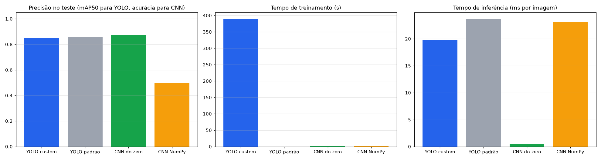
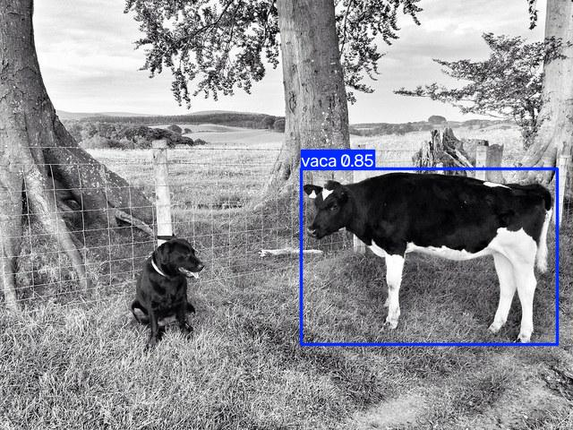
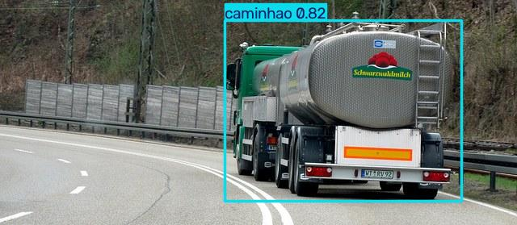

# FIAP - Faculdade de Informática e Administração Paulista

# FarmTech Solutions — O despertar da Rede Neural

## Grupo 30 — Fase 6, Capítulo 1 · turma 1TIAOA

## Integrantes

- Higor Henrique Garcia — RM 571820
- Vinicius Alves Lopes dos Anjos — RM 572814
- Humberto Salim — RM 570536
- Igor Zeviani Nogueira — RM 572822

## Vídeo (YouTube não listado, ≤ 5 min)

- Demonstração: **VIDEO_URL_AQUI**

## Notebook oficial

**[`HigorHenriqueGarcia_rm571820_pbl_fase6.ipynb`](HigorHenriqueGarcia_rm571820_pbl_fase6.ipynb)** — células executadas, com saídas.

[](https://colab.research.google.com/github/higorhg/farmtech-fase6-cap1/blob/main/HigorHenriqueGarcia_rm571820_pbl_fase6.ipynb)

Todo o passo a passo (dataset, treino, validação, teste, comparação e conclusões) está no notebook. Este README só
apresenta o projeto e indica onde encontrar cada parte.

## Descrição

Um cliente da FarmTech quer ver, na prática, como funciona um sistema de visão computacional. O cenário escolhido é o
**monitoramento de fazenda**: uma câmera que distingue **gado (`vaca`)** de **veículos de carga (`caminhao`)**, base
para contagem de animais e alerta de segurança patrimonial.

| Entrega | O que foi feito | Seção do notebook |
|---|---|---|
| 1 | Dataset de 80 imagens (40 por objeto: 32 treino / 4 validação / 4 teste) com rótulos YOLO | 2 |
| 1 | YOLO customizada (YOLOv8n) treinada com **30 e 60 épocas**, comparação de acurácia, erro e desempenho | 3 |
| 1 | Imagens de teste processadas pelo modelo | 3.3 |
| 2 | YOLO padrão (pré-treinada no COCO, sem ajuste) avaliada na mesma base | 4 |
| 2 | CNN treinada do zero para classificar a imagem | 5 |
| 2 | Comparação crítica: facilidade de uso, precisão, tempo de treino e tempo de inferência | 6 e 7 |

## Resultados medidos (conjunto de teste, 8 imagens, CPU)

| Abordagem | Métrica no teste | Treino | Inferência |
|---|---|---|---|
| YOLO customizada — 30 épocas | mAP50 = 0,819 | 207 s | 20,2 ms/imagem |
| YOLO customizada — 60 épocas | mAP50 = 0,849 | 390 s | 19,8 ms/imagem |
| YOLO padrão (COCO, sem treino) | mAP50 = 0,857 | não se aplica | 23,7 ms/imagem |
| CNN do zero — 40 épocas | acurácia = 0,875 | 2,4 s | 0,48 ms/imagem |
| CNN NumPy (didática) | acurácia = 0,500 | 1,5 s | 23,1 ms/imagem |

mAP50 (detecção) e acurácia (classificação) não são a mesma régua; a discussão está na seção 6 do notebook.



Exemplo de imagens de teste processadas pela YOLO customizada (60 épocas):

| | |
|---|---|
|  |  |

## Limitações declaradas

- **Rotulação:** as caixas vêm das anotações humanas originais do COCO 2017, convertidas para o formato YOLO (o mesmo
  exportado pelo Make Sense AI). Elas foram conferidas visualmente, mas não foram desenhadas pelo grupo no Make Sense.
- **Base pequena:** validação e teste têm 8 imagens cada; as métricas têm alta variância.
- **Imagens do COCO:** a YOLO padrão foi treinada nesse conjunto, o que a favorece na comparação.
- **Execução:** as saídas do notebook foram geradas em CPU local. A célula de configuração tem o caminho para Google
  Colab + Google Drive (monta o Drive e copia o dataset para `MyDrive/FarmTech_Fase6/`), mas essa rota não foi executada por nós.

## Divisão do grupo

| Responsável | Entrega |
|---|---|
| Higor Henrique Garcia — RM 571820 | Dataset real, YOLO customizada (30 × 60 épocas), YOLO padrão, notebook final, README e vídeo |
| Humberto Salim — RM 570536 | CNN do zero (arquitetura e motor NumPy em `cnn_numpy_humberto.py`) e estrutura do benchmark |
| Igor Zeviani Nogueira — RM 572822 | Integração inicial do notebook e documentação |
| Vinicius Alves Lopes dos Anjos — RM 572814 | Planejamento da fase e revisão |

## Estrutura

```text
HigorHenriqueGarcia_rm571820_pbl_fase6.ipynb   notebook oficial executado
build_notebook.py                              gera o notebook (sem saídas) a partir do código
cnn_numpy_humberto.py                          CNN em NumPy puro usada na seção 5.1
data/yolo_dataset/
  images/{train,val,test}/                     80 imagens (vaca_*.jpg, caminhao_*.jpg)
  labels/{train,val,test}/                     rótulos YOLO, um .txt por imagem
  manifest.json                                origem de cada imagem (id e URL no COCO)
runs/yolo_custom_{30,60}ep/                    curvas, matrizes de confusão e pesos finais (last.pt)
resultados/                                    imagens de teste processadas e tabela comparativa
tests/test_dataset.py                          confere a proporção 32/4/4 e os rótulos
```

## Como reproduzir

```bash
python -m venv .venv && source .venv/bin/activate
pip install -r requirements.txt
python -m unittest discover -s tests -q
python build_notebook.py
jupyter nbconvert --to notebook --execute --inplace HigorHenriqueGarcia_rm571820_pbl_fase6.ipynb
```

Em CPU a execução completa leva cerca de 11 minutos. Os tempos e as métricas variam um pouco conforme a máquina.

## Créditos

- Imagens e anotações: [COCO 2017](https://cocodataset.org) (imagens sob licenças Creative Commons; anotações CC BY 4.0).
- Detecção: [Ultralytics YOLOv8](https://github.com/ultralytics/ultralytics).
